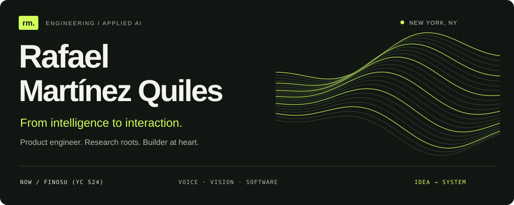
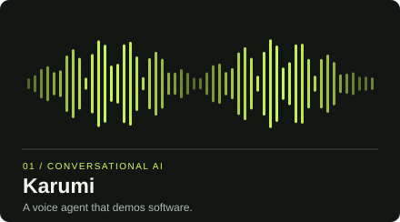
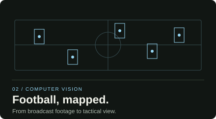
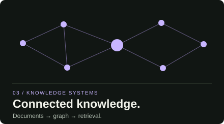
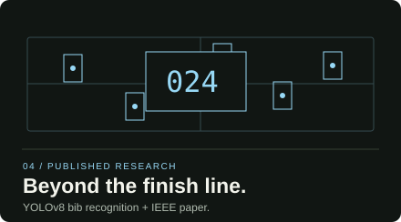
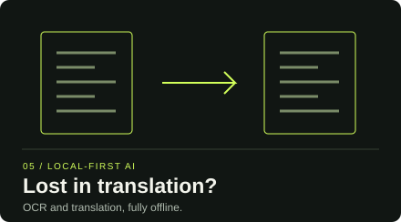
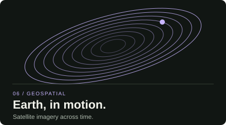

  

  <a href="https://www.linkedin.com/in/rafael-martinez-quiles/">LinkedIn</a> &nbsp; / &nbsp;
  <a href="mailto:rafa.martinezquiles@gmail.com">Email</a> &nbsp; / &nbsp;
  <a href="https://www.finosu.com/">Finosu</a>

### Software people use. Intelligence that does something.

I'm **Rafael**, a **Product Engineer at [Finosu (YC S24)](https://www.finosu.com/)**, based in **New York**. I build across software and applied AI, with projects spanning conversational agents, computer vision, knowledge retrieval, and data tooling.

I like the whole problem: how a system thinks, how it works, and how it feels to the person using it.

### From research to company-building

| Chapter | What I build |
| :--- | :--- |
| **Finosu · New York** Product Engineer · First full-time employee 2026–present | Lead engineering for loan origination: multi-agent AI orchestration, borrower experiences, and enterprise integrations. |
| **Agxes · San Francisco** Founding Engineer 2025–2026 | Built AI credit decisioning and data pipelines. Helped cut time-to-decision from approximately **90 days to under 5 minutes** for pilot lenders. |
| **UPM · Madrid** Artificial Intelligence Engineer 2023–2024 | Built real-time vision and OCR systems in the GATV lab for the EU NEMO project; co-authored research in **IEEE Transactions on Broadcasting**. |

Master’s in Business Analytics · Hult International Business School, 2025 Bachelor’s in Data Engineering and Systems · Universidad Politécnica de Madrid, 2024 Career details and outcomes: <a href="https://www.linkedin.com/in/rafael-martinez-quiles/">LinkedIn</a>

 

### Selected builds

Six ways I turn ideas into working systems. Explore the code, architecture, and setup in each repository.

<table>
<tr>
<td width="50%" valign="top">

 
<strong><a href="https://github.com/rafamartinezquiles/karumi">Karumi ↗</a></strong> 
A conversational demo agent combining voice interaction with browser automation. 
Python · Pipecat · ElevenLabs · OpenAI
</td>
<td width="50%" valign="top">

 
<strong><a href="https://github.com/rafamartinezquiles/football-players-tracking">Football Players Tracking ↗</a></strong> 
Detect and track players and the ball, then project the action onto a tactical pitch. 
OpenCV · Supervision · Transformers · Homography
</td>
</tr>
<tr>
<td width="50%" valign="top">

 
<strong><a href="https://github.com/rafamartinezquiles/full-stack-multimodal">Knowledge Graph &amp; RAG ↗</a></strong> 
Turn unstructured documents into connected entities and searchable knowledge. 
LangChain · Neo4j · OpenAI · Python
</td>
<td width="50%" valign="top">

 
<strong><a href="https://github.com/rafamartinezquiles/yolov8-bib-recognition">Race Bib Recognition ↗</a></strong> 
Detect race bib numbers in natural scenes; explore the research behind the IEEE publication. 
YOLOv8 · PyTorch · OpenCV · CUDA
</td>
</tr>
<tr>
<td width="50%" valign="top">

 
<strong><a href="https://github.com/rafamartinezquiles/real-time-translation">Offline OCR &amp; Translation ↗</a></strong> 
Extract text from images and PDFs and translate it locally, with a full-stack interface. 
Tesseract · Argos Translate · FastAPI · React
</td>
<td width="50%" valign="top">

 
<strong><a href="https://github.com/rafamartinezquiles/satellite-timelapse">Satellite Time-Lapse ↗</a></strong> 
Explore Sentinel-2 imagery through time-lapse videos and vegetation-index analytics. 
Planetary Computer · Xarray · NumPy · Streamlit
</td>
</tr>
</table>

**More experiments:** [automated data analysis](https://github.com/rafamartinezquiles/auto-data-agent) · [explainable vision](https://github.com/rafamartinezquiles/yolov11-explainable-ai) · [generative interiors](https://github.com/rafamartinezquiles/home-make-over) · [gesture-controlled games](https://github.com/rafamartinezquiles/ninja-fruit-game)

 

### Research meets the real world

**IEEE Transactions on Broadcasting · 2024** 
[Performance Evaluation of YOLOv8-Based Bib Number Detection in Media Streaming Race](https://doi.org/10.1109/TBC.2024.3414656) 
Co-authored research evaluating bib detection across models, datasets, and computing hardware. [Publication details at UPM ↗](https://iptc.upm.es/publications/performance-wvaluation-of-yolov8-based-bib-number-detection-in-media-streaming-ace/)

**AI Hack Night at Google · 2024** 
Second place in the demo challenge with an AI detective game combining data integration, semantic search, and knowledge graphs.

**n-aible · 2024–2025** 
Co-founded the AI society and served as president. Helped organize a 400-attendee AI for Good hackathon, build partnerships, and grow the community.

 

### My working toolkit

| Layer | Tools |
| :--- | :--- |
| **Product & APIs** | Python, TypeScript, React, FastAPI |
| **Models & perception** | PyTorch, TensorFlow, OpenCV, YOLO, MediaPipe |
| **Agents & knowledge** | Pipecat, LangChain, Neo4j, OpenAI |
| **Data & infrastructure** | SQL, PostgreSQL, Docker, AWS, GCP, Azure |

---

  <strong>Have something worth building?</strong> 
  <a href="mailto:rafa.martinezquiles@gmail.com">Let's talk ↗</a> &nbsp; · &nbsp;
  <a href="https://www.linkedin.com/in/rafael-martinez-quiles/">Follow the journey on LinkedIn</a>

